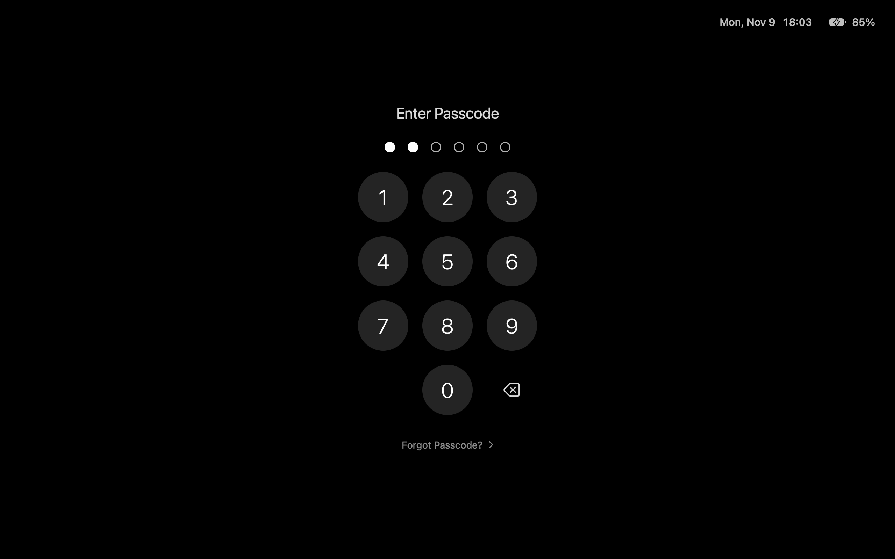
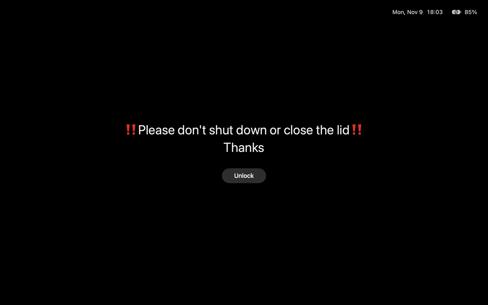

# MaskPad

[](https://github.com/gicek/MaskPad/actions/workflows/ci.yml)
[](https://github.com/gicek/MaskPad/releases/latest)

[](LICENSE)

MaskPad is a macOS menu bar app that covers your screens and blocks the keyboard and mouse without
locking the Mac. Everything underneath keeps running — downloads, builds, remote sessions and AI agents
that operate your apps — while anyone walking by can neither see nor use the Mac. Unlock it with a
6-digit passcode.

<table>
  <tr>
    <td align="center" width="50%">
      <br>
      <sub>Enter the passcode to unlock</sub>
    </td>
    <td align="center" width="50%">
      <br>
      <sub>An optional message, shown before the keypad</sub>
    </td>
  </tr>
</table>

## Features

- **Covers every display**, including full-screen apps, the menu bar, the Dock and notifications.
- **Blocks local input**: keyboard shortcuts, app switching, Force Quit, right-click, scrolling and
  gestures all stop working, and hot corners don't fire (the pointer can't reach the screen corners).
  Only the mouse pointer and clicks or touches on the keypad get through.
- **Can show your own message** in large type on the mask, such as "‼️Please don't shut down or
  close the lid‼️ Thanks": up to 120 characters and 3 lines, with an Unlock button that leads to the
  keypad. Keyboard digits only count after Unlock, and the mask returns to the message after 30
  seconds without input.
- **Unlocks with a 6-digit passcode**, typed on the on-screen keypad or on the keyboard. Five wrong
  attempts trigger a 30-second cooldown, and digits left half-entered are cleared after 30 seconds.
- **Shows the date, time and battery level** in the top-right corner of the mask, formatted for the
  app's language. The battery turns red below 20 % when not plugged in.
- **Keeps your work running**: apps under the mask keep rendering, and tools that operate individual
  windows (such as Computer Use agents) keep working. The Mac doesn't sleep or lock on its own while
  masked.
- **Works with remote access**: through macOS Screen Sharing you see the keypad and can unlock
  remotely.
- **Forgot your passcode?** "Unlock with Mac Password" locks the Mac; after you log in with your Mac
  password the mask is gone and you can set a new passcode.
- **Optional**: turn on automatically after a period of inactivity, dim the screens after 20 seconds,
  launch at login, and a global shortcut (⌃⌘L by default).
- **Turns on from other apps**: the `maskpad` command line and the `maskpad://on` URL, so a script, an
  AI agent or a launcher can cover the screen, for example when a long task starts.
- **Updates itself** through Sparkle: checks daily (can be turned off in Settings), or choose
  **Check for Updates** from the menu bar icon. Updates never check or relaunch while the mask is on.
- Available in English, 简体中文, 繁體中文, 日本語, Español, 한국어, Français and Deutsch.

## Getting Started

1. Download `MaskPad-<version>.dmg` from the
   [latest release](https://github.com/gicek/MaskPad/releases/latest), open it and drag MaskPad to
   Applications (or build it yourself, see [Building](#building)). MaskPad needs macOS 14 or later and
   runs on Apple silicon and Intel. Launch it; its icon appears in the menu bar.
2. In **Settings**, click **Open System Settings** in the Accessibility banner and drag MaskPad into
   the list. MaskPad needs this permission to block the keyboard and mouse.
3. Set a 6-digit passcode.
4. Choose **Turn On Screen Mask** from the menu bar icon, or press ⌃⌘L.

Opening MaskPad again while it is running shows Settings.

## Turning the Mask On from Other Apps

MaskPad can be turned on, but never off, from outside: any app can cover the screen, and only a person
at the Mac (or through Screen Sharing) can remove the mask, with the passcode. If there is no passcode
or no Accessibility permission yet, MaskPad opens Settings instead.

**Command line.** In Settings > General, **Install** next to "Command line tool" adds the `maskpad`
command to `/usr/local/bin` (it may ask for an administrator password); **Remove** takes it away. The
command is a link to MaskPad's own executable, so Settings offers to install it again if MaskPad moves.

```sh
maskpad on        # turn the mask on, starting MaskPad if needed
maskpad status    # print "on" or "off"
maskpad version   # print the MaskPad version
```

`maskpad on` waits until the mask is on and exits with 0, or with 1 if it can't be turned on (no
passcode or no Accessibility permission), so scripts and agents can check the result. Both commands exit
with 3 if MaskPad doesn't answer within 15 seconds, and an unknown command exits with 2.

**URL.** `maskpad://on` turns the mask on and `maskpad://status` does nothing visible; open them with
`open -g maskpad://on` or from any app that opens links.

Third-party launchers and automation tools that can run a command or open a URL can use either one.

## Security

MaskPad protects an unattended Mac from someone sitting down at it. It is not a replacement for the
macOS login password or FileVault.

- **Any app can turn the mask on**, through `maskpad://on` or the `maskpad` tool; none can turn it off.
- **Remote input is not blocked.** Input from macOS Screen Sharing and from tools that send events
  directly to apps bypasses the mask by design, so anyone with remote access to the Mac can still use
  it.
- **Only a person can use the keypad.** The mask's buttons accept clicks from a real mouse or
  trackpad, touches on a touch screen and clicks through Screen Sharing; the passcode can also be typed
  on a physical keyboard. Clicks, key presses and Accessibility actions from other processes, such as
  Computer Use agents working under the mask, are ignored, so they can't enter digits, start the
  wrong-passcode cooldown or lock the Mac. Ignored presses are logged with the process that sent them.
- **The passcode is 6 digits.** It is stored in the Keychain as a salted SHA-256 hash.
- **Restarting removes the mask.** After a restart (for example by holding the power button) the Mac
  falls back to its login password. If MaskPad itself crashes or is killed, the mask disappears and the
  Mac is left unlocked.
- **Locking the Mac removes the mask.** Anyone at the keyboard can use "Unlock with Mac Password" to
  lock the Mac, which interrupts whatever was running; getting back in still requires the Mac password.
  Closing the lid only removes the mask when macOS actually asks for the password on wake.
- **Private frameworks.** MaskPad uses SkyLight, DisplayServices and login.framework, which future
  macOS versions may change.

## How It Works

- **Mask windows** sit at the shielding window level on every display and Space. They use a 99 %
  opaque black background with `isOpaque = false`: fully opaque windows make WindowServer treat the
  apps beneath as occluded, and Chromium-based apps stop rendering.
- **Input blocking** is an HID-level `CGEventTap`. The pass/swallow rules live in `MaskTapPolicy`:
  pointer moves and left clicks pass, digits and Delete feed the keypad and are swallowed, everything
  else is swallowed. The key that triggered the shortcut gets its physical key-up through once, because
  macOS tracks key state per event source and would otherwise treat the next press as a repeat.
- **Kiosk mode** uses `NSApplication.presentationOptions` to hide the Dock and menu bar and disable
  app switching, Force Quit and logging out. A `PreventUserIdleDisplaySleep` assertion keeps the Mac
  awake.
- **Real lock detection** (`SystemLockTracker`): closing the lid locks the session immediately, but
  within the "require password after N minutes" grace period macOS unlocks again without a password.
  The mask is removed only after MaskPad's own lock request, a sleep longer than the password delay,
  or a lock that persists for 3 seconds.
- **Dimming** lowers brightness through DisplayServices and covers screens with a black overlay.
  Original brightness is saved before dimming and restored on wake or on the next launch.
- **The status bar** formats the date and time with the app's localization language and the system
  region's conventions (12/24-hour clock), and reads the internal battery from IOKit power sources.
  Macs without a battery show only the date and time.
- **The global shortcut** uses Carbon `RegisterEventHotKey`, which needs no extra permission.
- **Auto-engage** polls the HID idle time. Unlocking the mask and an active Screen Sharing session
  count as activity, since remote input doesn't reset the HID idle time.

## Building

Requirements: Xcode 27 or later, [XcodeGen](https://github.com/yonaskolb/XcodeGen), and Python 3 for
the string catalog. MaskPad runs on macOS 14 or later.

```sh
brew install xcodegen
make            # list all targets
make build      # build the Debug app into build/debug
make run        # build and launch it, quitting a running copy first
make test       # run the unit tests
make check      # string catalog check and unit tests; run before committing
make clean      # remove build output, fetched packages and Xcode's DerivedData for this project
make distclean  # clean, then remove the generated MaskPad.xcodeproj
```

Everything lands in `build/`, one folder per kind of build:

| Folder | Made by | Contents |
| --- | --- | --- |
| `build/debug` | `make build`, `make run` | `MaskPad.app`, Debug |
| `build/release` | `make release` (and `dist`) | `MaskPad.app` and `MaskPad-<version>-unnotarized.zip`, Developer ID–signed, not notarized |
| `build/dist` | `make dist`, `make publish` | `MaskPad-<version>.dmg`, `MaskPad-<version>.zip`, `appcast.xml`, notarized and stapled |

`build/release` and `build/dist` also hold `SHA256SUMS` and `BUILD_INFO`: version, build number, Git
commit (and whether the tree had uncommitted changes), build time, Xcode, architectures, signing
identity and notarization. The two folders can come from different runs, so check `BUILD_INFO` before
sharing a file. Only `build/dist` is for distribution: an unnotarized app downloaded from the internet is
blocked by Gatekeeper.

`build/DerivedData`, `build/SourcePackages` and `build/intermediates` hold intermediates.

None of these need Xcode open: they build with `xcodebuild` and generate the `.xcodeproj` from
`project.yml` themselves (it is not committed). Swift packages are fetched once into
`build/SourcePackages`, and Sparkle is pinned to an exact version in `project.yml`. Builds use the
Xcode selected with `xcode-select`, or `/Applications/Xcode.app` when that is the Command Line Tools;
set `DEVELOPER_DIR` to choose another. For full `xcodebuild` output, pass `XCODEBUILD_FLAGS=`.

### Developing in Xcode

To edit, debug or use SwiftUI previews in Xcode:

```sh
make open       # generate MaskPad.xcodeproj and open it in Xcode
make project    # regenerate it only
```

Regenerate after changing `project.yml` or adding, removing or renaming source files; the project picks
up files from disk only when it is generated. Builds started in Xcode go to Xcode's own DerivedData
folder, not `build/`; `make clean` removes that too.

### Signing

Without local configuration the app is ad-hoc signed. macOS then ties the Accessibility permission to
each build, so every rebuild has to be granted again. To avoid that, copy
`Config/MaskPad.local.xcconfig.example` to `Config/MaskPad.local.xcconfig` (ignored by Git) and set your
team and certificate. The test target uses the same signing, because the hardened-runtime app only
loads test code signed by the same team.

MaskPad is not sandboxed and uses private frameworks, so it is distributed with Developer ID rather
than through the Mac App Store.

### Release

Publishing a new version to GitHub:

```sh
make bump VERSION=1.2.3   # set the version, raise the build number, create release notes templates
                          # write the release notes in every language, then commit and push
make publish              # build, notarize and upload a draft GitHub release (not live yet)
make verify-release       # download the draft and check everything users and Sparkle will get
make go-live              # verify again, publish the draft, wait until the update feed serves it
```

Only the first three lines and testing the downloaded DMG are manual; `make bump` without `VERSION`
raises only the build number. Until `make go-live`, the release is a draft: nobody can see it, and
installed copies don't offer the update. `make verify-release` also works on a published release
(`VERSION=x.y.z` for an older one); for the latest release it also checks the live feed.

To build without publishing:

```sh
make release   # archive, export with Developer ID -> build/release (app and zip, not notarized)
make dist      # release, then DMG, notarize, staple, zip, appcast -> build/dist
```

`release`, `dist` and `publish` run `make check` first, then `Scripts/release.sh`; `verify-release` and
`go-live` run `Scripts/github_release.sh`. Release builds are universal (Apple silicon and Intel). In
`build/dist`, the DMG is for downloads and the zip is for Sparkle; `publish` uploads both with
`appcast.xml` and `SHA256SUMS`.

Sparkle compares the build number, so every release needs a higher one; `dist` and `publish` refuse a
build number that isn't higher than the live one.

Release notes are written in every language the app supports: `docs/release-notes/<version>.md` in
English and `<version>.<lang>.md` for each language in `Scripts/translations.py` (`zh-Hans`, `zh-Hant`,
`ja`, `es`, `ko`, `fr`, `de`). The appcast embeds all of them, and the update window shows the notes in
MaskPad's current language, or in English for other languages; the GitHub release shows the English
notes. `publish` refuses notes that are missing, empty or still the template, and `dist` warns.
`verify-release` checks that the appcast has every language.

The script checks everything it needs before the slow build, and says how to fix what is missing:

- a Developer ID Application certificate for the team in `Config/MaskPad.local.xcconfig`
- for `dist` and `publish`: [uv](https://docs.astral.sh/uv/) (`brew install uv`), which runs a pinned
  [dmgbuild](https://github.com/dmgbuild/dmgbuild) to lay out the DMG from `Scripts/dmg_settings.py`,
  and the DMG art in `design/dmg` (`make icons`)
- for `dist` and `publish`: a `notarytool` keychain profile, and the Sparkle private key in the login
  Keychain matching `SUPublicEDKey` (see [Updates](#updates))
- for `publish`: [gh](https://cli.github.com), logged in; a clean, pushed working tree; a version
  without a GitHub release (or draft) yet; release notes

The notarytool profile is the `NOTARY_PROFILE` environment variable, else `NOTARY_PROFILE` in
`Config/MaskPad.local.xcconfig`, else `MaskPad`:

```sh
xcrun notarytool store-credentials MaskPad --apple-id <apple-id> --team-id <team-id>
```

One notarization covers both files: the DMG is submitted, and its ticket is stapled to the DMG and to the
app before it is zipped (the app in `build/release` stays unstapled). If Apple rejects the submission,
the script prints the notary log. Before notarizing, the app inside the DMG is checked with
`codesign --strict`, so the DMG layout can't add anything that breaks the signature.

### Updates

MaskPad updates through [Sparkle](https://sparkle-project.org). The app reads
`https://github.com/gicek/MaskPad/releases/latest/download/appcast.xml`, so the appcast attached to the
newest GitHub release is the live feed. Every update is verified against the EdDSA public key
(`SUPublicEDKey` in `project.yml`); the private key is in the release Mac's login Keychain, and
`generate_appcast` signs with it. Back it up — without it, existing installs can't be updated (the
tool is in `build/SourcePackages` after any build):

```sh
build/SourcePackages/artifacts/sparkle/Sparkle/bin/generate_keys -x sparkle-key.txt
```

### Tests

Unit tests cover the passcode, keypad, input-tap rules, lock detection, brightness recovery, idle
detection and shortcuts. Tests never touch real state: the passcode store is in memory, settings use a
separate defaults domain, and no global shortcut or menu bar item is created.

## Localization

Strings live in `Scripts/translations.py` and are compiled into the string catalog:

```sh
make strings         # regenerate the catalog
make check-strings   # validate only
```

The script fails when a string in the code has no translation, a translation is unused, placeholders
don't match, or an interpolated value's type isn't registered in `INT_VARS` / `STRING_VARS`.

## Icons

The source artwork is in `design/logo`, and the DMG window background in `design/dmg/background.svg`.
Regenerate the app icon, the menu bar icon and the DMG art (background and volume icon) with:

```sh
make icons   # requires Node and uv; runs Scripts/build_icons.sh
```

The volume icon is drawn by `Scripts/build_dmg_volume_icon.py` with Pillow (which uv installs on the fly)
from this Mac's removable disk icon and the logo; `design/dmg/volume.png` is a preview of it.

## Logging

```sh
/usr/bin/log show --predicate 'subsystem == "com.gicek.maskpad"'
```

MaskPad logs when the mask turns on or off, when a real system lock is detected, when the shortcut
can't be registered, when an update relaunch waits for the mask to turn off, when a press on the mask
comes from another process and is ignored, and each `maskpad://` command with its result. It never
logs key input. Use `/usr/bin/log`, because zsh has a built-in `log` command.

## Project Layout

```
MaskPad/App          app entry, menu bar menu, settings model, updater, logging, maskpad command
MaskPad/Mask         mask windows, input blocking, keypad, passcode, lock detection, dimming
MaskPad/HotKeys      global shortcut
MaskPad/Permissions  Accessibility onboarding
MaskPad/Views        settings window
MaskPad/Resources    asset catalog and string catalog
Tests                unit tests
Scripts              build, release, string catalog and icon scripts
.github              CI workflow, issue and pull request templates
design/logo          source artwork
design/dmg           DMG background and volume icon
docs/images          README images
```

## Contributing

See [CONTRIBUTING.md](CONTRIBUTING.md). Report security issues privately, as described in
[SECURITY.md](SECURITY.md).

## License

MIT. See [LICENSE](LICENSE).
